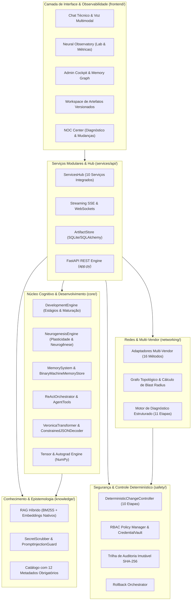

# VERONICA — Inteligência Artificial Nativa para Engenharia, Diagnóstico e Operação Autônoma de Redes

<p align="center">
  <strong>Plataforma de IA nativa construída desde os fundamentos matemáticos e tensores próprios, especializada em engenharia multi-vendor, diagnóstico determinístico em 11 etapas, controle seguro de mudanças em 10 etapas e desenvolvimento cognitivo contínuo com neurogênese estrutural.</strong>
</p>

---

## 1. Visão Geral Executiva

A **Veronica** é um ecossistema completo de inteligência artificial de alta fidelidade técnica, concebido para atender às exigências de missão crítica de operadoras de telecomunicações, data centers e redes corporativas complexas.

Diferente de sistemas baseados em chamadas de APIs de terceiros ou modelos de linguagem genéricos de caixa-preta, a Veronica foi desenvolvida **desde os fundamentos matemáticos**:
- **Motor Autograd Nativo sobre NumPy** (`core/neural`): Grafos dinâmicos com derivação analítica reversa e gradientes auditáveis (`gradcheck` com erro relativo $< 10^{-5}$).
- **Arquitetura Neural Própria (`VeronicaTransformer`)** (`core/transformer`): Positional embeddings senoidais ou RoPE (Rotary Position Embeddings), Multi-Head Causal Self-Attention com KV-Cache e decodificação autoregressiva por restrição gramatical (`ConstrainedJSONDecoder`).
- **Desenvolvimento Cognitivo & Neurogênese Estrutural** (`core/development`): Sistema de maturação cognitiva por estágios (`DevelopmentEngine`), neurogênese dinâmica baseada em novidade de estímulos (`NeurogenesisEngine`), memória multimodal de trabalho e episódica, e armazenamento binário de ultra-alta velocidade (`BinaryMachineMemoryStore`).
- **Orquestrador de Agente ReAct** (`core/agent`): Loop de raciocínio, ferramentas especializadas e observação para resolução autônoma de problemas técnicos.
- **RAG Híbrido com Epistemologia Estrita** (`knowledge`): Busca léxica BM25S combinada com embeddings vetoriais nativos, catálogo oficial com **12 metadados obrigatórios** e proteção determinística contra *Prompt Injection* e vazamento de credenciais.
- **Engenharia Multi-Vendor Padronizada** (`networking`): Adaptadores síncronos e assíncronos (`BaseVendorAdapter` e `AsyncVendorAdapter`) cobrindo 16 métodos padronizados para **Huawei VRP (v5/v8)**, **Cisco (IOS-XE, IOS-XR, NX-OS)**, **Juniper Junos**, **MikroTik RouterOS (v6/v7)**, **Nokia SR OS**, **Arista EOS** e **Fortinet FortiOS**.
- **Diagnóstico Estruturado em 11 Etapas** (`networking/diagnostics`): Motor investigativo somente leitura com grafo topológico de camadas L1-L4 e cálculo estrito de raio de impacto (*Blast Radius*).
- **Controlador Determinístico de Mudanças em 10 Etapas** (`safety/change_control`): Motor isolado dos pesos neurais que exige janela de manutenção, hash SHA-256 de plano, validação de pré-condições, detecção de modificação concorrente, pós-validação automática, rollback determinístico e auditoria imutável (com aprovação por voz expressamente proibida).
- **Interface Web Reativa e Neural Observatory** (`frontend` e `services/api`): Interface em React + TypeScript com Chat Técnico, Síntese e Reconhecimento de Voz, Neural Observatory em tempo real, Cockpit de Admin e Workspace com versionamento de artefatos.

---

## 2. Pilares Arquiteturais



### 2.1 Fundação Matemática e Neural (`core/neural` & `core/transformer`)
- Tensores com grafo computacional dinâmico e rastreamento de nós de histórico.
- Derivação analítica para todas as operações fundamentais (`add`, `sub`, `mul`, `div`, `matmul`, `pow`, `sum`, `mean`, `transpose`, `reshape`).
- Camadas modulares: `Linear`, `Embedding`, `LayerNorm`, `RMSNorm`, `Dropout`.
- Funções de ativação não lineares: `ReLU`, `GELU`, `Sigmoid`, `Tanh`, `Softmax`, `LogSoftmax`.
- Funções de perda e otimizadores: `CrossEntropyLoss`, `MSELoss`, `SGD` (com momentum) e `AdamW` (com weight decay desacoplado e escalonador `CosineWarmupScheduler`).
- `VeronicaTransformer` com suporte a `PositionalEncoding` e `RoPE`, Multi-Head Attention com projeções lineares explícitas e KV-Cache incremental.
- Geração autoregressiva assistida com amostragem (`temperature`, `top_k`, `top_p`) e decodificador JSON com restrição sintática e gramatical (`ConstrainedJSONDecoder`).

### 2.2 Neurogênese, Memória e Desenvolvimento Cognitivo (`core/development`)
- **Estágios Evolutivos**: Progressão ontogenética de estágios de desenvolvimento (`INFANT`, `CHILD`, `ADOLESCENT`, `SPECIALIST`, `EXPERT`) com metas cognitivas verificáveis.
- **Neurogênese Estrutural Dinâmica**: Geração de novos neurônios (`DynamicNeuron`) em circuitos especializados (`NeurogenesisCircuit`) acionados por surpresa de sinal e novos padrões lexicais/técnicos.
- **Sistema de Memória Multinível**:
  - *Memória de Trabalho*: Janela ativa de raciocínio e atenção de curto prazo.
  - *Memória Episódica*: Linha do tempo de interações, diagnósticos e experiências passadas.
  - *Grafo Semântico de Conceitos*: Rede associativa de nós conceituais e arestas ponderadas.
  - *Binary Machine Memory Store*: Serialização e indexação vetorial compacta de alta performance.
- **Vias de Percepção & Compreensão**: Córtex visual (`VisualPerceptionCortex`) para análise de topologias e diagramas, e córtex de leitura (`ReadingComprehensionCortex`) para assimilação de manuais técnicos.
- **Daemon de Aprendizado Autônomo** (`AutonomousCognitiveDaemon`): Processo em segundo plano com suporte a múltiplos workers para consolidação cognitiva (fase de "sono/sonho"), redução de entropia e fortalecimento sináptico.

### 2.3 Orquestrador ReAct & Agente Autônomo (`core/agent`)
- Mecanismo de resolução estruturada em ciclos **Pensamento -> Ação -> Observação -> Resposta**.
- Interface padronizada de ferramentas (`AgentTool`) com validação de esquema de entrada e resposta estruturada.
- Isolamento estrito entre ferramentas de consulta diagnóstica (somente leitura) e ferramentas operacionais.

### 2.4 Epistemologia e Conhecimento Híbrido (`knowledge/`)
- Separação mandatória entre **conhecimento paramétrico** (pesos do modelo neural) e **conhecimento documental** (indexação RAG com rastreabilidade formal).
- Preservação estrita dos **12 metadados obrigatórios** por fragmento de conhecimento:
  1. `chunk_id`
  2. `vendor`
  3. `family_model`
  4. `os_name`
  5. `version_build`
  6. `feature`
  7. `original_source`
  8. `source_uri`
  9. `page_section`
  10. `published_date`
  11. `consulted_date`
  12. `reliability_score` + `applicability_restrictions`
- Sanitizador de dados sensíveis (`SecretScrubber`): Redação automática de senhas, chaves criptográficas e SNMP communities (`[REDACTED_SECRET]`).
- Guarda contra Injeção de Prompts (`PromptInjectionGuard`): Detecção determinística e neutralização de instruções maliciosas contidas em manuais externos.
- Classificação epistemológica das afirmações da IA em três categorias explícitas:
  - **Fato Comprovado (`VERIFIED_FACT`)**
  - **Inferência Técnica (`TECHNICAL_INFERENCE`)**
  - **Hipótese Verificável (`HYPOTHESIS`)**

### 2.5 Engenharia de Redes & Diagnóstico em 11 Etapas (`networking/`)
- Contrato padronizado multi-vendor via `BaseVendorAdapter` (síncrono) e `AsyncVendorAdapter` (assíncrono) implementando **16 métodos fundamentais**:
  `discover_device`, `get_capabilities`, `get_version`, `get_running_config`, `get_operational_state`, `get_topology_neighbors`, `collect_diagnostics`, `validate_commands`, `generate_candidate`, `compare_configurations`, `check_preconditions`, `create_backup`, `prepare_rollback`, `apply_change`, `verify_change`, `rollback_change`.
- Suporte homologado a **Huawei VRP**, **Cisco IOS-XE / IOS-XR / NX-OS**, **Juniper Junos**, **MikroTik RouterOS**, **Nokia SR OS**, **Arista EOS** e **Fortinet FortiOS**.
- **Motor de Investigação Diagnóstica em 11 Etapas** (100% Somente Leitura):
  1. Recepção e parsing do sintoma operacional
  2. Mapeamento de escopo e identificação dos ativos envolvidos
  3. Coleta de telemetria e estado operacional não intrusivo
  4. Consulta topológica e análise de adjacências (L1-L4)
  5. Consulta documental contextualizada (RAG com 12 metadados)
  6. Formulação de hipóteses técnicas baseadas em regras de protocolos
  7. Ranqueamento de hipóteses por probabilidade e impacto
  8. Seleção de testes seguros de validação
  9. Análise de evidências e correlação de falhas
  10. Determinação conclusiva de causa-raiz ou declaração formal de incerteza
  11. Emissão de relatório estruturado com recomendações remediadoras

### 2.6 Motor Determinístico de Mudanças Seguras em 10 Etapas (`safety/change_control`)
- Execução isolada do modelo neural: os pesos não emitem comandos diretamente aos nós de produção.
- **Fluxo Obrigatório em 10 Etapas**:
  1. *Descoberta e Identificação Exata* do alvo (`vendor`, `os`, `version`).
  2. *Coleta de Baseline* e geração de assinatura criptográfica SHA-256 do estado em execução.
  3. *Análise de Impacto e Risco de Lockout*: Proteção estrita de rotas de gerência e portas de administração com exigência de rollback automático por timer (`commit confirmed`).
  4. *Planejamento e Pré-condições*: Validação de espaço em flash, recursos de CPU/RAM e dependências de protocolo.
  5. *Geração e Validação Sintática de Candidato*: Produção de diff estruturado.
  6. *Aprovação Humana Explícita*: Bloqueio estrito de aprovação por voz; obrigatoriedade de token criptográfico associado ao operador habilitado e janela de manutenção autorizada.
  7. *Execução Controlada com Verificação de Concorrência*: Nova checagem do hash de configuração; se outro engenheiro realizou commit concorrente, o processo é abortado imediatamente (`CONCURRENT_MODIFICATION_DETECTED`).
  8. *Pós-validação Automática Imediata*: Verificação de sessões de roteamento, interfaces e tráfego.
  9. *Rollback Automático Determinístico*: Em caso de divergência ou perda de telemetria, restauração instantânea do snapshot original.
  10. *Auditoria Imutável Encadeada por SHA-256*: Registro persistente e à prova de adulteração em `TamperEvidentAuditLog`.

---

## 3. Estrutura Completa do Repositório

```text
Veronica/
├── core/
│   ├── neural/                  # Tensores, Autograd, Camadas, Ativações, Losses, Otimizadores, Clipping, Gradcheck, Scalability
│   ├── tokenizer/               # Tokenizador técnico BPE com preservação de IPv4/IPv6, CIDRs, ASNs, interfaces e CLIs
│   ├── transformer/             # Configuração, Positional/RoPE, Attention com KV-Cache e VeronicaTransformer
│   ├── training/                # VeronicaTrainer, ContinuousLearningPipeline, Checkpointing com validação SHA-256
│   ├── inference/               # AutoregressiveGenerator, PrefixKVCache, ConstrainedJSONDecoder
│   ├── development/             # DevelopmentEngine, NeurogenesisEngine, DynamicNeuron, MemorySystem, Cortex Perceptual, AutonomousDaemon
│   ├── agent/                   # ReActOrchestrator, AgentTool, loops estruturados de raciocínio e execução
│   └── contracts.py             # Interfaces e protocolos de tipagem base do núcleo
├── knowledge/
│   ├── ingestion/               # Parsers multiformato, SecretScrubber, PromptInjectionGuard
│   ├── retrieval/               # RAG Híbrido (BM25S + Embeddings Neurais Próprios), busca em domínio aberto
│   └── sources/                 # Catálogo oficial multi-vendor com 12 metadados por fragmento
├── networking/
│   ├── vendors/                 # BaseVendorAdapter (16 métodos), AsyncVendorAdapter, modelos e adaptadores de fabricantes
│   ├── protocols/               # Analisadores determinísticos (BGP, OSPF, IS-IS, MPLS, EVPN, STP, LACP, Óptica DOM)
│   ├── topology/                # Grafo topológico multi-camada e cálculo do raio de impacto (Blast Radius)
│   └── diagnostics/             # Motor estruturado de investigação diagnóstica em 11 etapas (somente leitura)
├── safety/
│   ├── policies/                # RBACPolicyManager, CredentialVault, Auditoria encadeada SHA-256
│   ├── change_control/          # DeterministicChangeController (10 etapas), FSM e travas de blast radius
│   └── rollback/                # RollbackOrchestrator, validação de baselines e reversão determinística
├── services/
│   ├── api/                     # Aplicação FastAPI (app.py), ServicesHub (services_hub.py), Streaming SSE/WebSocket
│   └── workspace/               # ArtifactStore (SQLite / SQLAlchemy) com suporte a versionamento e diffs
├── frontend/
│   ├── index.html               # Ponto de entrada web com interface responsiva completa
│   ├── src/                     # Código React + TypeScript (App.tsx, Admin.tsx, main.tsx, styles.css)
│   ├── package.json             # Dependências da interface
│   └── vite.config.ts           # Configuração de build e proxies do Vite
├── tests/                       # Suíte abrangente de testes automatizados com pytest e Hypothesis
│   ├── test_phase1_neural_math.py
│   ├── test_phase2_transformer_and_training.py
│   ├── test_phase3_to_7_knowledge_networking_safety.py
│   ├── test_phase10_continuous_learning.py
│   ├── test_phase16_api_gui_and_multimodal.py
│   ├── test_agent_ecosystem_properties.py
│   └── test_development_and_neurogenesis.py
├── docs/                        # Documentação técnica e arquitetural de referência
│   ├── ARCHITECTURE.md          # Especificação aprofundada da arquitetura e decisões de engenharia
│   ├── INTERFACES.md            # Contratos de APIs internas, adaptadores de fabricantes e endpoints
│   ├── DATASETS.md              # Esquemas de metadados, corpus de treinamento e incidentes operacionais
│   ├── METRICS_AND_ACCEPTANCE.md# Critérios formais de aceitação, fórmulas matemáticas e limites de tolerância
│   ├── RISKS_AND_LIMITATIONS.md # Matriz de riscos operacionais (R-01 a R-12) e salvaguardas
│   └── ROADMAP.md               # Roteiro evolutivo dos trilhos Neural, de Redes e de Interface
├── run_veronica.py              # Ponto de entrada CLI e inicializador do servidor web Uvicorn
├── pyproject.toml               # Configuração do projeto, empacotamento e dependências
├── Dockerfile                   # Imagem Docker multi-stage com usuário não-privilegiado
└── docker-compose.yml           # Orquestrador local com persistência de dados em volumes
```

---

## 4. Instalação e Execução

### 4.1 Requisitos do Sistema
- **Python**: versão 3.11 ou superior
- **Node.js**: versão 18 ou superior (para compilação do frontend, se necessário)
- **Sistemas Operacionais Suportados**: Linux (Debian, Ubuntu, RHEL), macOS e Windows 10/11 com PowerShell

### 4.2 Configuração do Ambiente Virtual Local

No Windows (PowerShell):
```powershell
# Criação e ativação do ambiente virtual
python -m venv .venv
.\.venv\Scripts\Activate.ps1

# Instalação das dependências
pip install -e .
```

No Linux / macOS (Bash):
```bash
python3 -m venv .venv
source .venv/bin/activate
pip install -e .
```

### 4.3 Inicialização da Aplicação Completa

Execute o ponto de entrada principal:
```powershell
python run_veronica.py --host 0.0.0.0 --port 8000
```

URLs de Acesso:
- **Interface Gráfica Integrada**: [http://localhost:8000](http://localhost:8000)
- **Painel Administrativo & Gráfico de Memória**: [http://localhost:8000/admin](http://localhost:8000/admin)
- **Documentação Interativa Swagger / OpenAPI**: [http://localhost:8000/docs](http://localhost:8000/docs)

### 4.4 Diagnóstico Rápido via CLI (Linha de Comando)

A Veronica permite executar investigações diagnósticas diretas pelo terminal sem necessidade de abrir o navegador:
```powershell
python run_veronica.py --diagnose "Sessão BGP em estado Active no NE8000-CORE-01 e OSPF preso em EXSTART no ASR9K-CORE-02" --devices NE8000-CORE-01 ASR9K-CORE-02
```

### 4.5 Execução via Docker e Docker Compose

```bash
docker compose up --build -d
```
O contêiner executa sob o usuário não-root `veronica`, expõe a porta `8000` e mantém o estado em volume persistente `veronica_runtime_data`.

---

## 5. Execução dos Testes Automatizados

A suíte de testes cobre desde gradientes matemáticos analíticos até endpoints de desenvolvimento contínuo e propriedades de agente:

```powershell
# Execução completa da suíte de testes
pytest -v

# Execução direcionada a um módulo específico
pytest tests/test_phase1_neural_math.py -v
pytest tests/test_agent_ecosystem_properties.py -v
pytest tests/test_development_and_neurogenesis.py -v
```

---

## 6. Endpoints Principais da API REST

| Categoria | Método | Rota | Descrição |
|---|---|---|---|
| **Conversação & Chat** | `GET` / `POST` | `/api/conversations` | Listagem e criação de sessões conversacionais |
| | `POST` | `/api/conversations/{id}/messages` | Envio de mensagem técnica multimodal |
| | `POST` | `/api/conversations/{id}/stream` | Streaming de resposta via SSE |
| | `POST` | `/api/conversations/{id}/agent-stream`| Streaming reativo com raciocínio ReAct |
| **Workspace & Artefatos** | `GET` / `PUT` | `/api/workspace/artifacts` | Leitura e persistência de documentos versionados |
| | `GET` | `/api/workspace/artifacts/{id}/versions` | Histórico e diffs de versões do artefato |
| **Desenvolvimento & Neurogênese** | `GET` | `/api/development/status` | Estágio evolutivo, contagem de neurônios e narrativa |
| | `GET` | `/api/development/neurons` | Topologia de neurônios nascidos e circuitos |
| | `GET` | `/api/development/memories` | Linha do tempo de memórias episódicas |
| | `GET` | `/api/memory/binary/stats` | Estatísticas do armazenamento binário de alta performance |
| | `POST` | `/api/development/see` | Estímulo perceptual visual (topologias/diagramas) |
| | `POST` | `/api/development/read` | Estímulo de leitura com assimilação conceitual |
| | `POST` | `/api/development/consolidate` | Ciclo de sono e consolidação sináptica |
| **Aprendizado Autônomo** | `GET` | `/api/development/autonomous-learning/status` | Estado dos workers do daemon autônomo |
| | `POST` | `/api/development/autonomous-learning/start` | Disparo do aprendizado contínuo em background |
| | `POST` | `/api/development/autonomous-learning/stop` | Interrupção segura do daemon |
| **Neural Observatory** | `GET` | `/api/neural/architecture` | Estrutura de camadas, tensores e parâmetros |
| | `GET` | `/api/neural/telemetry` | Telemetria real de CPU, RAM, VRAM e gradientes |
| | `WS` | `/api/neural/telemetry/ws` | Telemetria contínua via WebSocket |
| **Operação de Redes** | `GET` | `/api/network/inventory` | Inventário multi-vendor e Digital Twin |
| | `GET` | `/api/network/topology` | Grafo de adjacências e conexões |
| | `POST` | `/api/network/diagnostics` | Disparo da investigação em 11 etapas |
| | `POST` | `/api/network/changes` | Submissão de proposta de mudança segura |
| | `POST` | `/api/network/changes/{id}/approve` | Aprovação humana formal (com token e janela) |
| | `POST` | `/api/network/changes/{id}/execute` | Execução controlada com salvaguarda de rollback |
| **Áudio & Voz** | `POST` | `/api/audio/consent` | Registro de consentimento explícito para captura |
| | `POST` | `/api/audio/transcribe` | Transcrição com normalização de termos de redes |
| | `POST` | `/api/audio/synthesize` | Síntese de voz técnica |
| **Administração & Auditoria** | `GET` | `/api/admin/overview` | Métricas gerais de saúde do ecossistema |
| | `GET` | `/api/admin/memory-graph` | Grafo navegável de conceitos e nós |
| | `GET` | `/api/security/audit` | Trilha criptográfica de auditoria SHA-256 |

---

## 7. Índice da Documentação Técnica (`docs/`)

Para aprofundamento nos contratos, arquiteturas, esquemas e critérios operacionais da plataforma, consulte os documentos dedicados:

- [ARCHITECTURE.md](file:///c:/Users/alexn/Desktop/Veronica/docs/ARCHITECTURE.md): Arquitetura detalhada em camadas, grafo matemático, pipeline autônomo e decisões de design.
- [INTERFACES.md](file:///c:/Users/alexn/Desktop/Veronica/docs/INTERFACES.md): Especificação completa dos contratos Python, os 16 métodos multi-vendor e os serviços da API.
- [DATASETS.md](file:///c:/Users/alexn/Desktop/Veronica/docs/DATASETS.md): Esquemas de metadados dos 12 campos obrigatórios, formato de datasets JSONL e incidentes validados.
- [METRICS_AND_ACCEPTANCE.md](file:///c:/Users/alexn/Desktop/Veronica/docs/METRICS_AND_ACCEPTANCE.md): Fórmulas de gradcheck, taxas de acerto diagnósticas, convergência e validação empírica.
- [RISKS_AND_LIMITATIONS.md](file:///c:/Users/alexn/Desktop/Veronica/docs/RISKS_AND_LIMITATIONS.md): Matriz de riscos operacionais R-01 a R-12, salvaguardas de lockout e neutralização de ameaças.
- [ROADMAP.md](file:///c:/Users/alexn/Desktop/Veronica/docs/ROADMAP.md): Planejamento evolutivo dos trilhos Neural, de Redes e de Interface Web/Multimodal.
