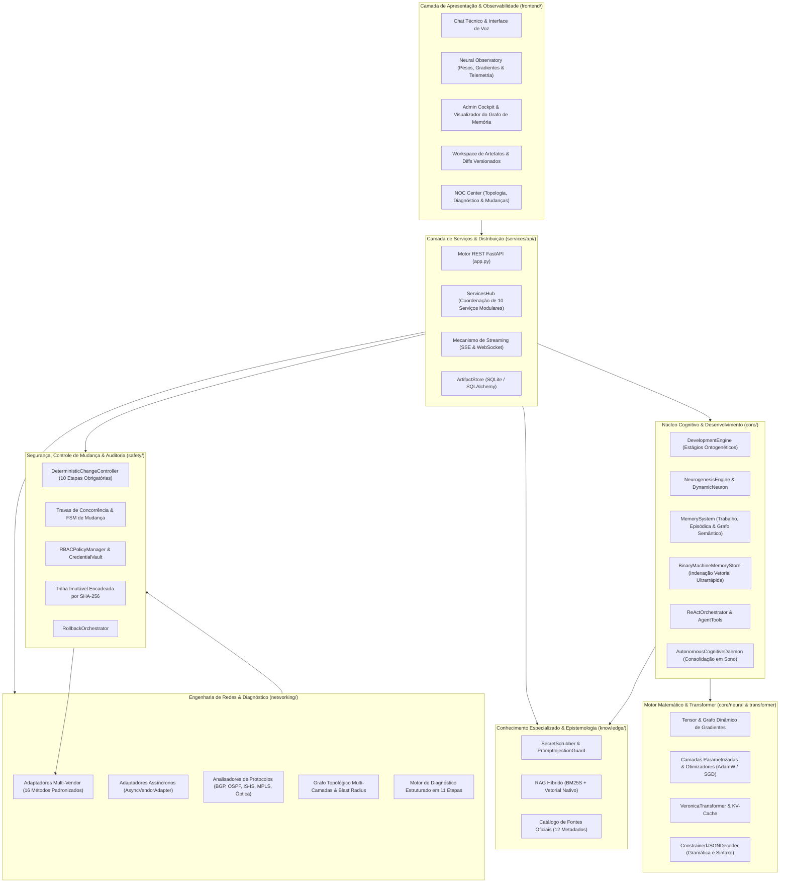

# Arquitetura Técnica — VERONICA (Net Neural AI)

## 1. Visão Geral e Princípios Fundamentais

A **Veronica** é uma plataforma de Inteligência Artificial nativa desenvolvida especificamente para engenharia, operação, diagnóstico estruturado e automação determinística de redes de computadores multi-vendor.

O projeto não utiliza invólucros (*wrappers*) de modelos de linguagem de terceiros, modelos pré-treinados comerciais ou pesos opacos de caixa-preta. Toda a inteligência da plataforma é construída sobre:
1. **Fundação Matemática Nativa**: Diferenciação automática reversa (Autograd sobre NumPy), tensores com grafos computacionais auditáveis e verificação formal por diferenças finitas (`gradcheck`).
2. **Arquitetura Neural Própria (`VeronicaTransformer`)**: Atenção causal multi-cabeças com KV-Cache e posições codificadas por RoPE ou codificação senoidal.
3. **Desenvolvimento Cognitivo e Neurogênese Dinâmica**: Evolução ontogenética por estágios, criação de neurônios estruturais mediante surpresa sensorial, memória episódica/semântica e persistência binária de alto desempenho.
4. **Agente ReAct e Inferência Gramatical Restrita**: Loops de raciocínio estruturados com decodificação vinculada a esquemas formais (`ConstrainedJSONDecoder`).
5. **Conhecimento Híbrido com Epistemologia Transparente**: RAG híbrido (BM25S + embeddings próprios), preservação de 12 metadados obrigatórios e categorização das respostas em Fatos Comprovados, Inferências Técnicas e Hipóteses.
6. **Engenharia Multi-Vendor Padronizada**: Adaptadores síncronos e assíncronos cobrindo 16 operações operacionais essenciais para os principais fabricantes de telecomunicações.
7. **Diagnóstico Estruturado em 11 Etapas**: Mecanismo de isolamento de causa-raiz estritamente em modo de leitura (*read-only*).
8. **Motor Determinístico de Mudança em 10 Etapas**: Controlador independente do modelo neural, com travas de concorrência, cálculo de raio de impacto (*Blast Radius*), rollback determinístico e auditoria em cadeia criptográfica SHA-256.

---

## 2. Diagrama Macro da Arquitetura do Sistema

---

## 3. Detalhamento dos Componentes

### 3.1 Motor Matemático e Autograd (`core/neural/`)
Localizado em [core/neural/tensor.py](file:///c:/Users/alexn/Desktop/Veronica/core/neural/tensor.py):
- Implementa a classe fundamental `Tensor`, que encapsula um array multidimensional em `NumPy` acompanhado de sua closure computacional e gradientes (`grad`).
- Cada nó do grafo computacional rastreia seus predecessores (`_prev`) e sua função de gradiente analítico local (`_backward`).
- Backpropagation executado por ordenação topológica estrita, zerando acumulações indevidas com `zero_grad()`.
- O módulo [gradcheck.py](file:///c:/Users/alexn/Desktop/Veronica/core/neural/gradcheck.py) aplica a equação de diferenças finitas centrais:
  $$\frac{\partial \mathcal{L}}{\partial x_i} \approx \frac{\mathcal{L}(x + \epsilon e_i) - \mathcal{L}(x - \epsilon e_i)}{2\epsilon}$$
  garantindo erro relativo $< 10^{-5}$ em todas as primitivas matemáticas.

### 3.2 Arquitetura `VeronicaTransformer` (`core/transformer/`)
Localizado em [core/transformer/model.py](file:///c:/Users/alexn/Desktop/Veronica/core/transformer/model.py):
- Suporta codificação posicional senoidal e Rotary Positional Embeddings (`RoPE`).
- Projeção de atenção causal multi-cabeças (`MultiHeadAttention`) equipada com `PrefixKVCache` para otimização da complexidade temporal de geração de tokens de $\mathcal{O}(N^2)$ para $\mathcal{O}(N)$.
- Camadas de normalização configuráveis entre `LayerNorm` e `RMSNorm`.
- Decodificador autoregressivo com suporte a amostragem top-k, top-p (nucleus sampling), temperatura e restrição estruturada de saída via [ConstrainedJSONDecoder](file:///c:/Users/alexn/Desktop/Veronica/core/inference/constrained_json.py).

### 3.3 Desenvolvimento Cognitivo, Neurogênese e Memória (`core/development/`)
Localizado em [core/development/](file:///c:/Users/alexn/Desktop/Veronica/core/development/):
- **Evolução Ontogenética (`DevelopmentEngine`)**: Controla as fases de maturação do sistema:
  - `INFANT`: Aprendizado de átomos fundamentais e sintaxe básica.
  - `CHILD`: Relações causais simples entre estados de interfaces e rotas.
  - `ADOLESCENT`: Correlação topológica e análise de adjacências.
  - `SPECIALIST`: Domínio avançado de BGP, MPLS, engenharia de tráfego e segment routing.
  - `EXPERT`: Investigação de falhas multivariadas e planejamento de mudanças seguras.
- **Neurogênese Estrutural (`NeurogenesisEngine`)**:
  - Instancia `DynamicNeuron` integrados a circuitos dinâmicos (`NeurogenesisCircuit`).
  - Novos neurônios são gerados quando o sinal de entrada apresenta divergência ou novidade superior ao limiar configurado (`novelty_threshold`), permitindo expansão contínua sem degradação do conhecimento prévio.
- **Sistema de Memória Multinível (`MemorySystem`)**:
  - `WorkingMemory`: Janela atencional imediata com capacidade dinâmica.
  - `EpisodicMemory`: Registro temporal indexado de interações e resoluções de problemas.
  - `ConceptGraph`: Grafo semântico constituído de nós de conceitos (`ConceptNode`) e relações ponderadas (`ConceptEdge`).
  - `BinaryMachineMemoryStore`: Formato binário ultra-compacto para busca vetorial e associação semântica de baixíssima latência.
- **Daemon Cognitivo Autônomo (`AutonomousCognitiveDaemon`)**:
  - Executa em segundo plano com múltiplos workers simultâneos.
  - Responsável pela fase de consolidação cognitiva (equivalente ao sono/sonho biológico), reorganizando pesos, realizando poda (*pruning*) de conexões ruidosas e indexando memórias recentes.

### 3.4 Agente ReAct (`core/agent/orchestrator.py`)
- O `ReActOrchestrator` implementa ciclos deliberativos estruturados:
  1. **Thought (Pensamento)**: Análise analítica da solicitação ou estado atual.
  2. **Action (Ação)**: Invocação de uma ferramenta registrada em `AgentTool`.
  3. **Observation (Observação)**: Captura da saída determinística retornada pela ferramenta.
  4. **Final Answer (Resposta Final)**: Síntese estruturada das constatações.
- Todas as ações executadas pelo agente respeitam estritamente as políticas de isolamento de segurança.

### 3.5 Sistema de Conhecimento Híbrido (`knowledge/`)
- **Separação Epistêmica**: Os pesos neurais do modelo são estritamente isolados da base documental.
- **Preservação de 12 Metadados Obrigatórios**: Todo trecho indexado no catálogo oficial ([knowledge/sources/catalog.py](file:///c:/Users/alexn/Desktop/Veronica/knowledge/sources/catalog.py)) preserva fabricante, modelo, sistema operacional, versão exata, fonte original, URI, seção/página, datas de publicação e consulta, pontuação de confiabilidade e restrições de aplicabilidade.
- **Segurança de Entrada**:
  - `SecretScrubber`: Substituição imediata de senhas, hashes e credenciais por identificadores opacos (`[REDACTED_SECRET]`).
  - `PromptInjectionGuard`: Varredura determinística contra instruções camufladas em documentações técnicas.

### 3.6 Engenharia Multi-Vendor e Diagnóstico em 11 Etapas (`networking/`)
- **Contrato de 16 Métodos Padronizados**: Implementado em [networking/vendors/adapters.py](file:///c:/Users/alexn/Desktop/Veronica/networking/vendors/adapters.py) e [networking/vendors/async_adapters.py](file:///c:/Users/alexn/Desktop/Veronica/networking/vendors/async_adapters.py).
- **Cobertura Homologada**:
  - Huawei VRP (V8 / V5)
  - Cisco Systems (IOS-XE, IOS-XR, NX-OS)
  - Juniper Networks (Junos OS)
  - MikroTik (RouterOS v6 / v7)
  - Nokia (SR OS)
  - Arista Networks (EOS)
  - Fortinet (FortiOS)
- **Motor Diagnóstico em 11 Etapas** ([networking/diagnostics/engine.py](file:///c:/Users/alexn/Desktop/Veronica/networking/diagnostics/engine.py)):
  - Execução 100% somente leitura.
  - Correlaciona telemetria, topologia e regras de protocolo.
  - Formulação de hipóteses técnicas com verificação de precedência causal.
  - Caso os dados coletados sejam insuficientes, o motor declara formalmente incerteza e indica com precisão os comandos adicionais necessários.

### 3.7 Controlador Determinístico de Mudanças em 10 Etapas (`safety/change_control/`)
- Localizado em [safety/change_control/controller.py](file:///c:/Users/alexn/Desktop/Veronica/safety/change_control/controller.py):
- Garante total blindagem operacional através das seguintes fases imutáveis:
  1. *Descoberta*: Validação de fabricante, SO e versão.
  2. *Baseline*: Cálculo do hash SHA-256 da configuração ativa.
  3. *Análise de Risco de Lockout*: Verificação de interfaces OOB e imposição de `commit confirmed`.
  4. *Planejamento e Pré-requisitos*: Verificação de saúde de hardware e dependências.
  5. *Geração de Candidato e Diff*: Geração de diff unificado estritamente padronizado.
  6. *Aprovação Humana Formal*: Validação criptográfica do token de aprovação atrelado à janela de manutenção; comandos falados por voz são bloqueados por especificação.
  7. *Execução com Detecção de Concorrência*: Nova coleta do hash de baseline. Divergências acionam aborto imediato (`CONCURRENT_MODIFICATION_DETECTED`).
  8. *Pós-validação*: Bateria de checagem imediata de saúde de protocolos e vizinhanças.
  9. *Rollback Automático*: Caso a pós-validação falhe ou a sessão seja degradada, reversão imediata para o baseline.
  10. *Auditoria Imutável*: Registro encadeado em SHA-256 no log à prova de adulteração.

### 3.8 Camada de Aplicação, Hub de Serviços e Workspace (`services/api/`)
- Coordenada por [services/api/services_hub.py](file:///c:/Users/alexn/Desktop/Veronica/services/api/services_hub.py) e [services/api/app.py](file:///c:/Users/alexn/Desktop/Veronica/services/api/app.py).
- Conexão em tempo real via Server-Sent Events (SSE) e WebSockets para métricas do Neural Observatory e telemetria de hardware (CPU, RAM, GPU, VRAM).
- [services/api/workspace/store.py](file:///c:/Users/alexn/Desktop/Veronica/services/api/workspace/store.py): Gerenciamento de artefatos com histórico formal de versões e controle de modificações no workspace.

---

## 4. Decisões Arquiteturais Fundamentais (ADRs)

1. **ADR-01: Autograd Auditável sem Frameworks Externos de Pesos**
   - *Decisão*: Construir o motor de tensores e backward pass explicitamente sobre NumPy.
   - *Justificativa*: Garantir transparência total em auditorias de missão crítica, previsibilidade matemática de gradientes e independência absoluta de ecossistemas externos de pesos fechados.
2. **ADR-02: Separação Rígida entre Inteligência Cognitiva e Execução de Rede**
   - *Decisão*: O modelo neural gera propostas, diagnósticos e planos, mas não possui privilégios de execução direta sobre os equipamentos.
   - *Justificativa*: Eliminar riscos de execução catastrófica decorrentes de alucinações de modelos probabilísticos.
3. **ADR-03: Proibição Estrita de Aprovação Operacional por Voz**
   - *Decisão*: O canal de voz é restrito à navegação, consultas e geração de planos preliminares.
   - *Justificativa*: Ambientes de NOC apresentam ruídos de fundo e ambiguidades fonéticas que não oferecem a integridade necessária para alterações em infraestruturas críticas.
4. **ADR-04: Transparência Epistemológica em 3 Níveis**
   - *Decisão*: Cada conclusão da Veronica deve ser explicitamente etiquetada como `VERIFIED_FACT`, `TECHNICAL_INFERENCE` ou `HYPOTHESIS`.
   - *Justificativa*: Evitar que o engenheiro operador tome como verdade inquestionável deduções estatísticas que demandem validação empírica.
