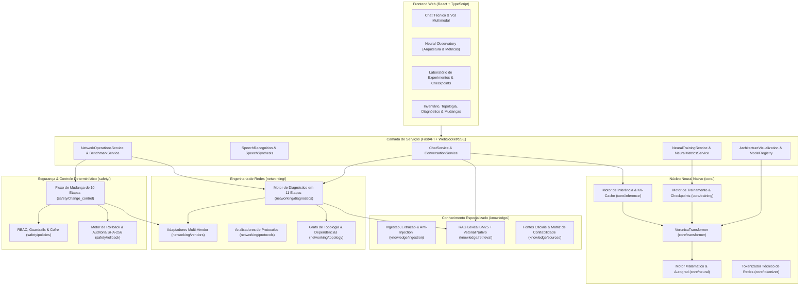

# Arquitetura Técnica — VERONICA (Net Neural AI)

## 1. Visão Geral

**Veronica** é uma plataforma nativa de Inteligência Artificial especializada em engenharia, administração, operação, diagnóstico e automação segura de redes de computadores. Diferente de soluções baseadas em wrappers de APIs comerciais ou pesos pré-treinados de terceiros, a Veronica possui:

1. **Núcleo Neural Próprio (`core/`)**: Motor de álgebra tensorial com diferenciação automática (Autograd) construído do zero sobre NumPy, camadas parametrizadas, otimizadores (`SGD`, `AdamW`), tokenizador técnico especializado em redes e arquitetura **VeronicaTransformer** treinada do zero (com RoPE/Positional Encoding, Multi-Head Causal Self-Attention, KV-Cache, RMSNorm/LayerNorm e Feed-Forward GELU).
2. **Sistema Híbrido de Conhecimento (`knowledge/`)**: Separação estrita entre **conhecimento paramétrico** (pesos aprendidos pelo modelo) e **conhecimento documental** (base indexada com RAG lexical BM25 + embeddings próprios da Veronica, preservando 12 campos obrigatórios de metadados e detecção de conflitos/obsolescência).
3. **Engenharia e Diagnóstico de Redes (`networking/`)**: Adaptadores padronizados por fabricante/sistema operacional/versão (Huawei VRP, Cisco IOS-XE/IOS-XR/NX-OS, Juniper Junos, MikroTik RouterOS, Nokia SR OS, Arista EOS, Fortinet FortiOS, etc.), motor de topologia e motor de investigação diagnóstica em 11 etapas.
4. **Motor Determinístico de Configuração Segura (`safety/`)**: Controlador de mudanças 100% independente do modelo neural, implementando o fluxo obrigatório de **10 etapas** (Descoberta, Baseline, Análise de Impacto, Planejamento, Simulação, Aprovação Humana Explícita, Execução Controlada, Pós-validação, Rollback e Auditoria Imutável em cadeia SHA-256), RBAC e Cofre de Credenciais.
5. **Interface Web Multimodal & Neural Observatory (`services/api/` e `frontend/`)**: Chat técnico com distinção visual entre fatos documentados e inferências, conversação por voz com consentimento explícito e trava de segurança operacional, e o **Neural Observatory (Neural Lab)** para inspeção gráfica da arquitetura neural, telemetria real de hardware e treinamento interativo em tempo real.

---

## 2. Diagrama de Arquitetura em Camadas



---

## 3. Estrutura do Repositório

```text
veronica/
├── core/
│   ├── neural/          # Tensores com Autograd, Neurônios, Camadas, Ativações, Losses, Otimizadores, Gradcheck
│   ├── tokenizer/       # Tokenizador técnico BPE + preservação de IPv4/IPv6/CIDR/ASN/Interfaces/CLI
│   ├── transformer/     # Embeddings, RoPE/Positional, Multi-Head Causal Attention, Blocos Transformer
│   ├── training/        # Loop de treinamento, DataLoader, Clipping, Telemetria, Checkpoints e Experimentos
│   └── inference/       # Decodificação autoregressiva, KV-Cache, Top-k/Top-p, Controle de cancelamento
├── knowledge/
│   ├── ingestion/       # Parsers (MD, TXT, HTML, JSON, XML, Config), Sanitização de Prompt Injection
│   ├── retrieval/       # Indexador BM25 + Embeddings próprios, Detector de Conflitos e Obsolescência
│   └── sources/         # Catálogo de fontes oficiais, metadados obrigatórios (12 campos) e corpus inicial
├── networking/
│   ├── vendors/         # Interface BaseVendorAdapter (16 métodos) + Huawei, Cisco, Juniper, MikroTik, Nokia, Arista, Fortinet
│   ├── protocols/       # Regras e máquinas de estado para BGP, OSPF, IS-IS, MPLS, EVPN/VXLAN, STP, LACP, Óptica
│   ├── topology/        # Descoberta LLDP/CDP/BGP, Grafo de adjacências e Cálculo de raio de impacto (Blast Radius)
│   └── diagnostics/     # Investigador em 11 etapas combinando Regras + Topologia + RAG + Modelo Neural
├── safety/
│   ├── policies/        # RBAC, Cofre de Credenciais (Vault), Sanitizador de Comandos e Políticas Read-Only
│   ├── change_control/  # Máquina de estados determinística das 10 Etapas Obrigatórias de Mudança
│   └── rollback/        # Gerenciador de backups, verificação pós-mudança, rollback e Auditoria Imutável SHA-256
├── services/
│   └── api/             # Aplicação FastAPI, 10 Serviços modulares, Persistência SQLite/PostgreSQL, Streaming SSE/WS
├── frontend/            # Aplicação React + TypeScript (Chat, Voz, Neural Observatory, Experimentos, NOC Center)
├── tests/               # Suíte completa de testes automatizados (matemáticos, neurais, RAG, diagnóstico, segurança, API)
└── docs/                # Documentação de Arquitetura, Interfaces, Datasets, Métricas, Riscos e Roadmap
```

---

## 4. Decisões Arquiteturais Fundamentais

1. **Autograd explícito e auditável sobre NumPy**: Cada operação tensorial (`matmul`, `add`, `relu`, `gelu`, `softmax`, `layernorm`, `rmsnorm`, `cross_entropy`) possui implementação matemática explícita da derivada analítica no passo `backward()`, validada por diferenças finitas centrais:
   $$\frac{\partial \mathcal{L}}{\partial x_i} \approx \frac{\mathcal{L}(x + \epsilon e_i) - \mathcal{L}(x - \epsilon e_i)}{2\epsilon}$$
2. **Isolamento entre Conhecimento Documental e Pesos Neurais**: O upload ou ingestão de um documento atualiza imediatamente o índice documental (com rastreabilidade de fonte, versão e página), mas **jamais altera automaticamente os pesos do modelo** nem políticas de segurança.
3. **Separação entre Sugestão Neural e Execução em Rede**: O modelo neural Veronica atua como copiloto cognitivo e gerador de planos/hipóteses. Toda interação com equipamentos passa obrigatoriamente pelo controlador determinístico (`ChangeControlEngine`), que é somente leitura por padrão e exige aprovação humana vinculada a hash de plano e janela de manutenção para qualquer alteração.
4. **Epistemologia Transparente**: Toda resposta técnica da Veronica classifica suas afirmações em:
   - **Fato Comprovado (`VERIFIED_FACT`)**: Extraído diretamente de documentação oficial indexada ou saída real de coleta read-only.
   - **Inferência Técnica (`TECHNICAL_INFERENCE`)**: Dedução lógica baseada em estado operacional + regras de protocolo.
   - **Hipótese (`HYPOTHESIS`)**: Possibilidade que requer teste seguro adicional para confirmação.
